# Quick Innovation | Predictive Model Based on KAN and Convolutional Layers

Single-step prediction model family update, incorporating KAN and CKAN (Convolutional Kolmogorov-Arnold Network) into the single-step prediction model. We have added new models such as KAN, KANConv, CNN-KAN, LSTM-KAN, TCN-KAN, Transformer-KAN, GRU-KAN, CNN-LSTM-KAN, etc., achieving high-precision predictions. This helps everyone grasp hot topics and publish articles early!
Environment framework: Python 3.9, PyTorch 1.8 or above are required for running.
Complementary files: detailed environment setup and installation tutorials, model and parameter explanation documents.
Usage object: those who need papers or graduation projects.
Code guarantee: detailed code comments, ready to run without modification.
Introduction to KAN and KAN Convolution:
Some researchers have extended the innovative architecture concept of KAN to convolutional neural networks, changing the classic linear transformation of convolution to a learnable nonlinear activation function in each pixel, proposing and open-sourcing KAN Convolution (CKAN). KAN Convolution is very similar to convolution but not applying dot product between kernels and corresponding pixels in the image, but applying a learnable nonlinear activation function to each element, then adding them up.
Experimental comparison shows that KAN Convolution achieves certain prediction effects with very small parameter quantities, which has research value in subsequent lightweight prediction network models!
When KAN network replaces the final linear layer, it shows good performance.
Visualization of related innovative models:
Update introduction:
Preface
This article introduces a single-step prediction model based on CNN-LSTM-KAN network based on the previous introduction of power transformer (Appendix attached to dataset). The detailed introduction of the power transformer dataset can be referred to in the following text:
1. Introduction to the Electric Power Transformer Data Set and Preprocessing
1.1 Preprocessing of Electric Power Transformer Data and Visualization
1.2 Single-step Prediction Preprocessing
2 Single-step Prediction Model Based on CNN-LSTM-KAN
2.1 Definition of CNN-LSTM-KAN Network Model
2.2 Setting parameters and training the model
50 epochs, MSE is 0.26269, the single-step prediction model based on CNN-LSTM-KAN has a significant effect, the model can fully extract the spatiotemporal features of the sequence, converges quickly, has excellent performance, high prediction accuracy, KAN network shows good performance when used as the final linear layer.
3 Results Visualization and Model Evaluation
3.1 Visualization of Prediction Results
3.2 Model Evaluation
Previously Interesting Content
Time Series Forecasting: Analysis and comparison of LSTM, ARIMA, Holt-Winters, SARIMA models
Wind Speed Forecasting (I) Data Set Introduction and Preprocessing
Wind Speed Forecasting (II) EMD-LSTM Model Based on Pytorch
Wind Speed Forecasting (III) EMD-LSTM-Attention Model
Wind Speed Forecasting (IV) EMD-Transformer Model Based on Pytorch
Wind Speed Forecasting (V) EMD-CNN-LSTM Model Based on Pytorch
Wind Speed Forecasting (VI) EMD-CNN-GRU Parallel Model Based on Pytorch
CEEMDAN + Combination Forecast Model (BiLSTM-Attention + ARIMA)
CEEMDAN + Combination Forecast Model (CNN-LSTM + ARIMA)
CEEMDAN + Combination Forecast Model (Transformer - BiLSTM + ARIMA)
CEEMDAN + Combination Prediction Model (CNN-Transformer + ARIMA)  
Multi-Feature Variable Sequence Forecasting (I) - CNN-LSTM Wind Speed Forecasting Model  
Multi-Feature Variable Sequence Forecasting (II) - CNN-LSTM-Attention Wind Speed Forecasting Model  
Multi-Feature Variable Sequence Forecasting (III) - CNN-Transformer Wind Speed Forecasting Model  
Multi-Feature Variable Sequence Forecasting (IV) Transformer-BiLSTM Wind Speed Forecasting Model  
Multi-Feature Variable Sequence Forecasting (V) CEEMDAN+CNN-LSTM Wind Speed Forecasting Model  
Multi-Feature Variable Sequence Forecasting (VI) CEEMDAN+CNN-Transformer Wind Speed Forecasting Model  
Predictive Model Based on the Particle Swarm Optimization Algorithm SSA - CEEMDAN-BiLSTM-Attention  
Predictive Model Based on the Particle Swarm Optimization Algorithm SSA - CEEMDAN-Transformer-BiGRU  
Superior Predictive Model: Secondary Decomposition-Combination Prediction  
Multi-Feature Variable Sequence Forecasting (VII) CEEMDAN+Transformer-BiLSTM Prediction Model  
Multi-Feature Variable Sequence Forecasting (VIII) Predictive Model Based on the Particle Swarm Optimization Algorithm SSA-CEEMDAN-BiLSTM Prediction Model  
Multi-Feature Variable Sequence Forecasting (11) Predictive Model Based on Pytorch TCN-GRU  
VMD + CEEMDAN Secondary Decomposition, CNN-LSTM Prediction Model  
VMD + CEEMDAN Secondary Decomposition, CNN-Transformer Prediction Model  
VMD + CEEMDAN Secondary Decomposition, Transformer-BiGRU Prediction Model  
Predictive Model - Code All-in-One Kit Based on Particle Swarm Optimization Algorithm SSA  
Introduction to Electric Power Transformer Data Set and Preprocessing  
 | Sci-Tech 1st Class High Innovation Predictive Model!
END
2. Friends who enjoy the content can follow, give the article a "like", share on social media or discuss in groups.

## Images

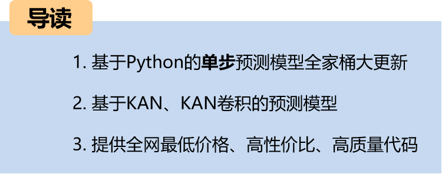

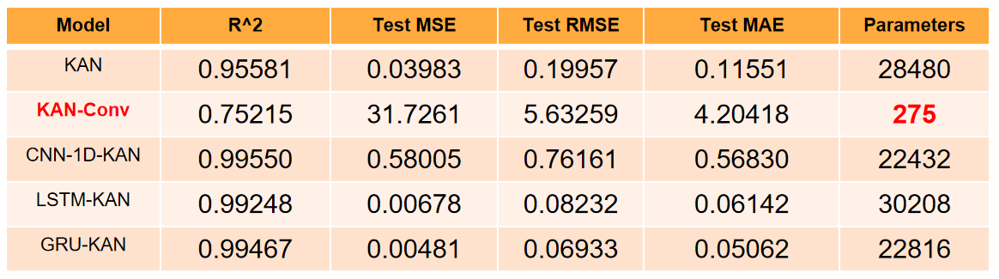
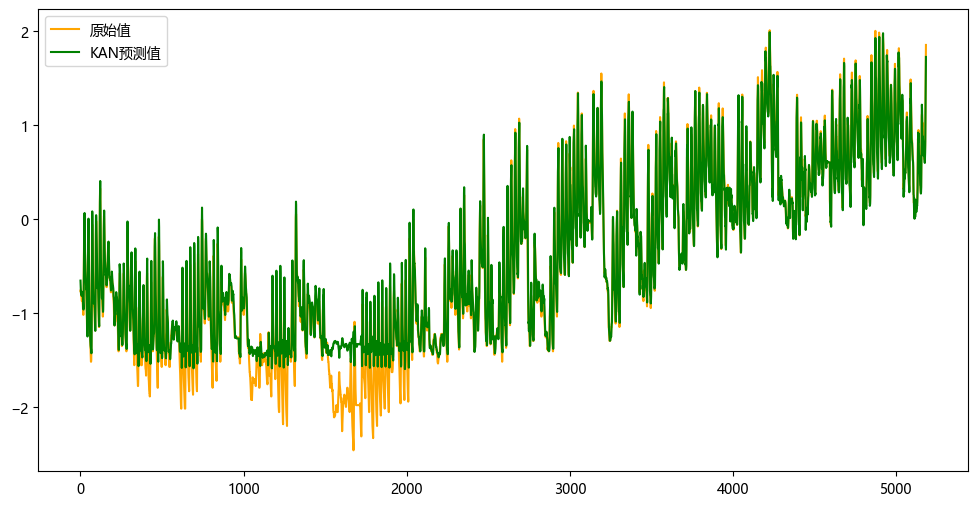
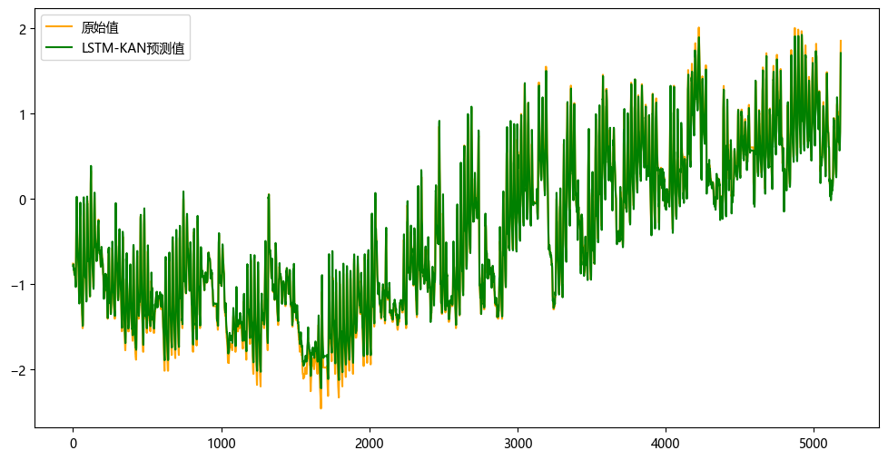
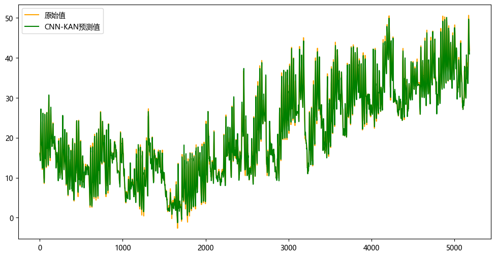
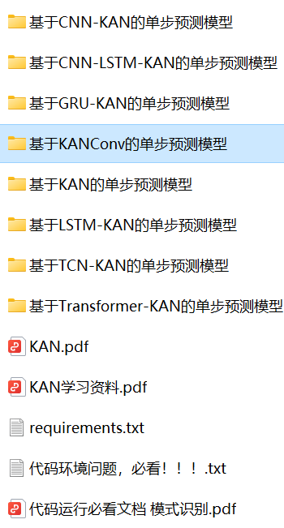

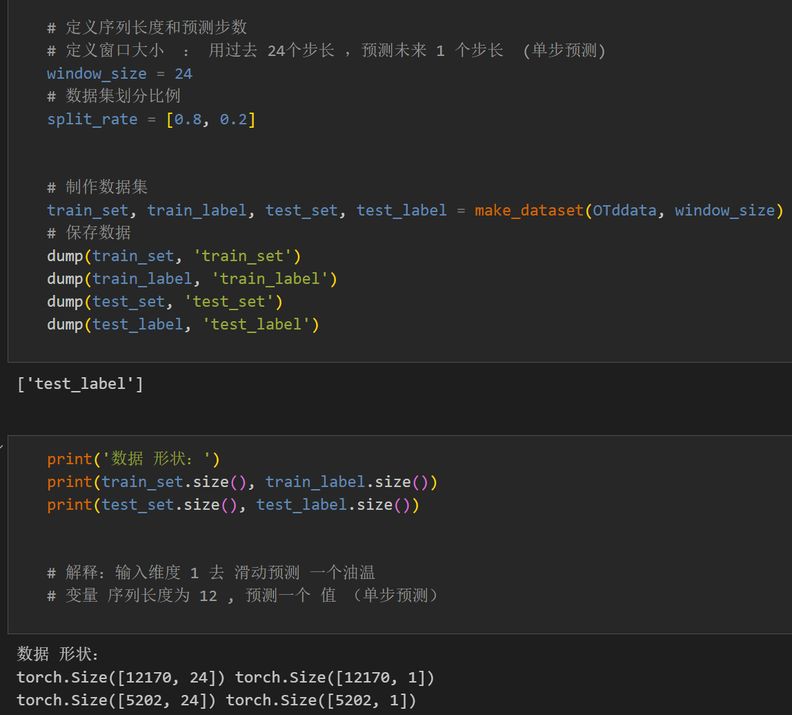
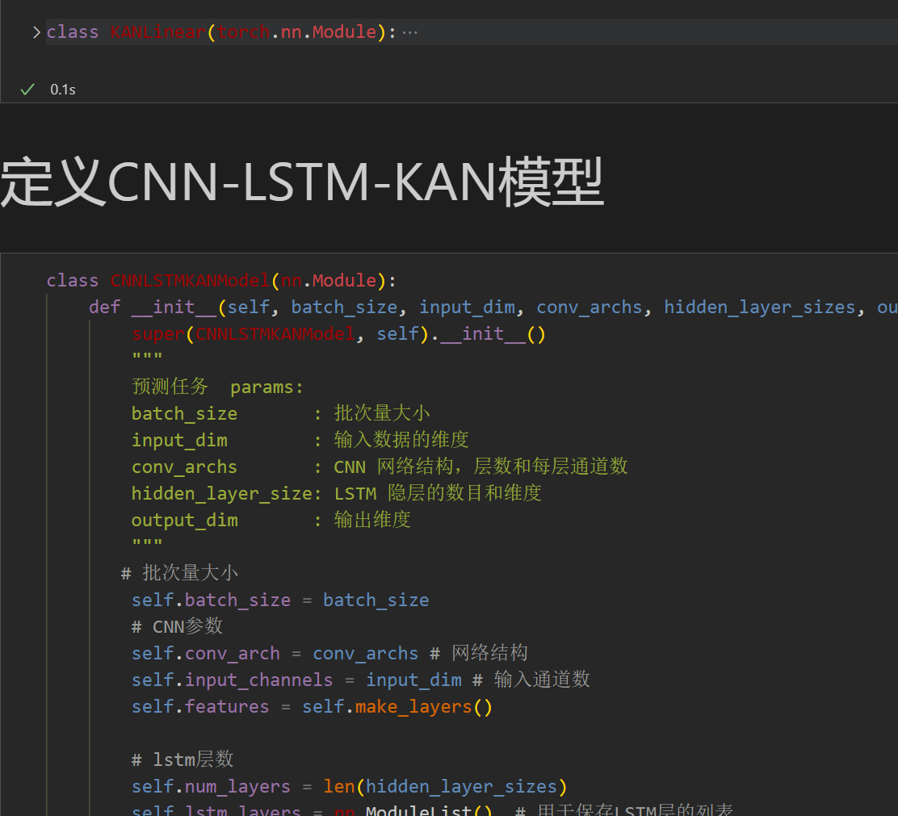
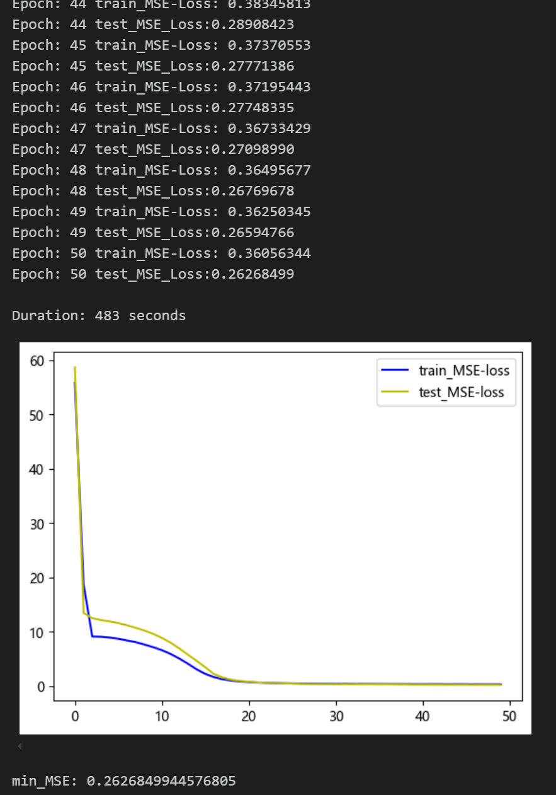
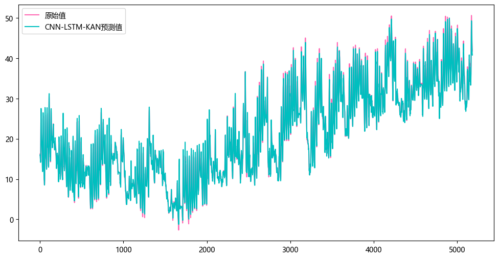
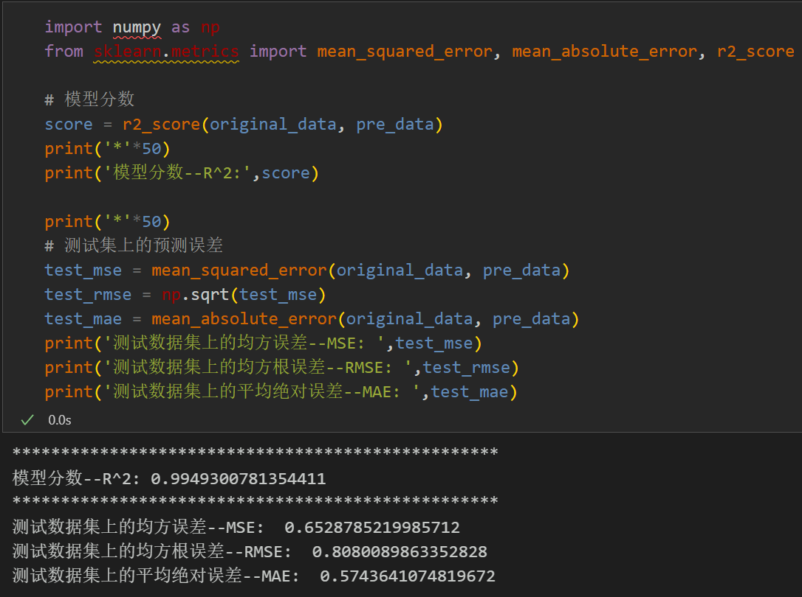

<!-- PAYMENT_BLOCK -->

## Get this dataset

- Payment link (Stripe): [Buy now](https://buy.stripe.com/3cs8yP7sY87d0vu9AB)
- Payment QR code: 

<!-- /PAYMENT_BLOCK -->
